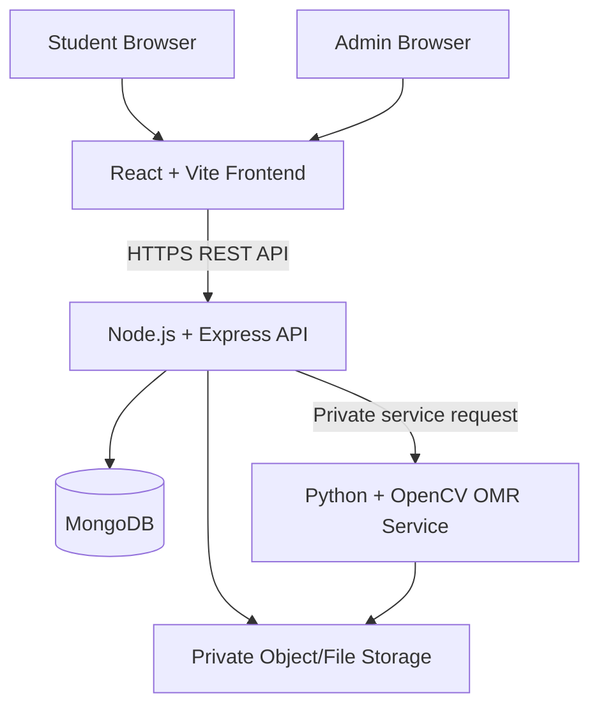

# Technical Requirements Document (TRD)
## Education Committee Competition Management System

- **Version:** 1.0
- **Architecture:** React SPA + Express REST API + MongoDB + Python OpenCV service
- **Target load:** 50–200 students per competition

## 1. Architecture overview



The browser must never connect directly to MongoDB or the OMR service. The Express API is the authorization and business-logic boundary. The OMR service should only be reachable privately from the backend in production.

## 2. Technology and baseline versions
- Frontend: React with Vite, JavaScript or TypeScript (TypeScript recommended for larger teams).
- Routing: React Router.
- Forms: React Hook Form or controlled forms with schema validation.
- UI: reusable CSS design tokens or a consistent component library; mobile-first layout.
- API client: `fetch` or Axios with a single configured base URL and error handling.
- Backend: supported Node.js LTS, Express, Mongoose.
- Validation: Zod/Joi/express-validator; use the same rules conceptually across layers.
- Authentication: bcrypt password hashing; JWT or server-side sessions. Prefer secure, HttpOnly, SameSite cookies for browser sessions if the deployment setup supports them correctly.
- Database: MongoDB Atlas or secured MongoDB deployment.
- OMR: Python 3, OpenCV, NumPy, Pillow (only as needed).
- Tests: Vitest/React Testing Library for frontend; Node test runner/Jest + Supertest for API; pytest for OMR service.
- Deployment: separate frontend, API, and OMR service deployments; managed MongoDB; HTTPS.

Pin tested dependency versions in lock files. Do not blindly upgrade dependencies immediately before an exam.

## 3. Service boundaries
### React frontend
Responsibilities:
- Render student and admin pages.
- Client-side validation for usability.
- Display exam timer and autosave state.
- Submit user actions to API.
- Never calculate authoritative final marks.
- Never store secrets or correct answer keys in the client bundle.

### Express API
Responsibilities:
- Authentication, authorization, input validation, rate limiting.
- Competition, registration, question, attempt, OMR, result, and audit workflows.
- Server-side exam timing and scoring.
- Validate all data from frontend and OMR service.
- Enforce result publication and privacy rules.
- Issue short-lived service requests to the OMR service.

### MongoDB
Responsibilities:
- Store users, competitions, registrations, questions, attempts, OMR submissions, results, and audit events.
- Enforce unique indexes for registration and roll number.
- Use transactions where supported and appropriate; otherwise design idempotent workflows.

### Python OpenCV service
Responsibilities:
- Accept a validated image reference or private upload.
- Check file decoding, dimensions, orientation, template alignment, and quality.
- Normalize/crop the fixed template and detect filled bubbles.
- Return structured detections and warnings.
- Never choose a guessed answer when detection is ambiguous.
- Never publish or calculate official final score independently.

## 4. Security model
- HTTPS for all public production traffic.
- Passwords hashed using bcrypt with a suitable work factor.
- Admin role checked in backend middleware on every protected route.
- No public admin registration. Seed/create the first admin using a documented one-time CLI or secure deployment procedure.
- Store secrets only in environment variables/secret manager.
- If using cookies, configure `HttpOnly`, `Secure` in production, `SameSite`, CSRF protection where required, and a strict CORS policy.
- If using bearer tokens, keep access tokens short-lived and avoid persistent localStorage for sensitive long-lived tokens.
- Rate-limit login, registration, result lookup, and file upload routes.
- Validate IDs, enums, body size, content types, and request schemas.
- Protect against NoSQL injection; never pass arbitrary user-supplied objects directly into Mongo queries.
- Add Helmet and production-safe error handling; do not return stack traces to clients.
- OMR files are private, access-controlled, and never served from a public static folder.
- Log security events without logging passwords, tokens, full private data, or image contents.

## 5. API conventions
- Prefix: `/api/v1`
- JSON request/response bodies except multipart image upload.
- Use consistent errors:
```json
{
  "error": {
    "code": "VALIDATION_ERROR",
    "message": "Please correct the highlighted fields.",
    "requestId": "server-generated-id"
  }
}
```
- HTTP codes: 200 success, 201 created, 204 no content, 400 validation, 401 unauthenticated, 403 unauthorized, 404 not found, 409 conflict, 413 payload too large, 429 rate limit, 500 unexpected error.
- Pagination: `?page=1&limit=25`; clamp maximum limit.
- Dates stored as UTC timestamps; competition schedules have an explicitly configured local timezone (default `Asia/Kolkata`).
- Use idempotency or unique submission constraints for submit operations.

## 6. Main API surface
All routes are under `/api/v1`.

### Authentication
- `POST /auth/register` — create student account (if account creation is enabled separately from competition registration).
- `POST /auth/login`
- `POST /auth/logout`
- `GET /auth/me`

### Competitions and registration
- `GET /competitions` — public published competitions.
- `GET /competitions/:competitionId` — public competition details without answer key.
- `POST /competitions/:competitionId/registrations` — authenticated student registration.
- `GET /me/registrations`
- `GET /admin/competitions`
- `POST /admin/competitions`
- `PATCH /admin/competitions/:competitionId`
- `POST /admin/competitions/:competitionId/publish`
- `POST /admin/competitions/:competitionId/close-registration`

### Questions
- `GET /competitions/:competitionId/exam/questions` — eligible student-safe questions/options only.
- `POST /admin/competitions/:competitionId/questions`
- `PATCH /admin/questions/:questionId`
- `POST /admin/competitions/:competitionId/answer-key/finalize` — audited action.

### Attempts
- `POST /competitions/:competitionId/attempts` — start or resume eligible attempt.
- `PATCH /attempts/:attemptId/answers` — save selected answers.
- `POST /attempts/:attemptId/submit` — idempotent submit.
- `GET /attempts/:attemptId/status` — own attempt only.

### OMR
- `POST /competitions/:competitionId/omr-submissions` — upload image and associate roll number/registration.
- `GET /admin/omr-submissions?status=needs_review`
- `GET /admin/omr-submissions/:submissionId`
- `PATCH /admin/omr-submissions/:submissionId/review` — confirm/correct detected answers with reason.
- `POST /admin/omr-submissions/:submissionId/finalize`

### Results
- `GET /me/results?competitionId=...`
- `GET /admin/competitions/:competitionId/results/preview`
- `POST /admin/competitions/:competitionId/results/publish`
- `GET /competitions/:competitionId/merit-list` — only published, approved fields.
- `GET /admin/competitions/:competitionId/merit-list.csv`

### Audit
- `GET /admin/audit-events` — Admin only, paginated.

## 7. OMR service contract
Private service endpoint example: `POST /internal/omr/process`.
- Authenticated with service-to-service secret or private network identity.
- Input: internal submission ID, safe file reference, template version.
- Output includes `status`, `templateVersion`, `answers[]`, `qualityChecks[]`, `warnings[]`, `processedAt`.
- Per-answer fields: `questionNumber`, `detectedOption` (`A|B|C|D|null`), `confidence` (0–1 if calibrated), `state` (`detected|blank|multiple|uncertain`).
- Do not treat an uncalibrated confidence value as a probability. Validate thresholds against labeled sample sheets.
- A response is a detection proposal, not a final result.
- Add request timeout, retry policy for transient errors, and idempotent processing.

## 8. Operational requirements
- `/api/v1/health` returns basic service status without secrets.
- Readiness check verifies essential dependencies without exposing connection strings.
- Structured logs with request ID and severity.
- Database backups and restore rehearsal before live use.
- Monitor API errors, OMR failure rate, queue/backlog, and storage capacity.
- Add graceful shutdown and bounded request/file sizes.
- Keep separate development, staging, and production environment configurations.

## 9. Testing requirements
- Unit tests: scoring, tie-breaking, date eligibility, roll-number generation.
- API tests: permissions, duplicate registration, no answer-key leakage, idempotent submit, result privacy.
- OMR tests: clean, rotated, skewed, low-light, blank, multiple-filled, and unsupported-template images.
- Integration tests: online and verified OMR submissions enter the same scoring pipeline.
- Load test: 200 simulated students accessing registration/exam endpoints; test realistic request bursts.
- Security tests: unauthorized admin route, invalid token, upload spoofing, oversized file, NoSQL injection payloads.
- Manual test: mobile browser, slow connection, interrupted upload, exam timeout.

## 10. Deployment topology
- Frontend: static hosting with SPA fallback and environment-configured API URL.
- API: Node service on managed application hosting.
- OMR: private Python service; do not expose publicly unless protected.
- Database: MongoDB Atlas with least-privilege database user, network access rules, backups.
- Files: private object storage or private persistent storage; signed URLs only when needed and short-lived.
- Secrets configured through deployment platform, not committed to Git.
