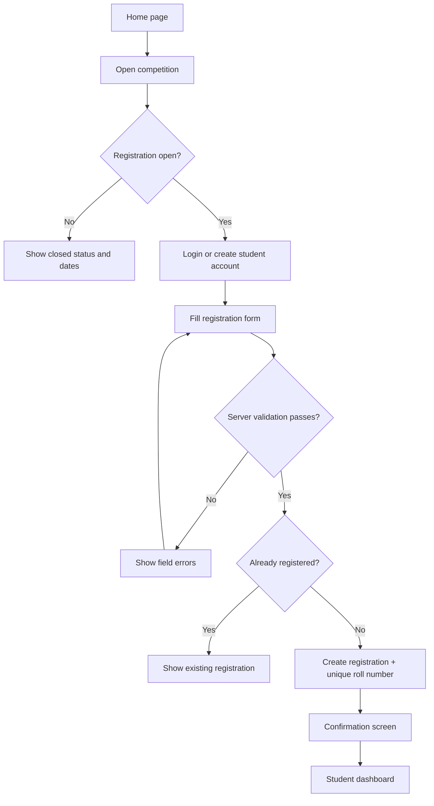
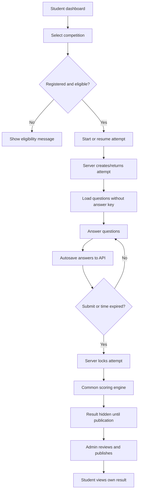
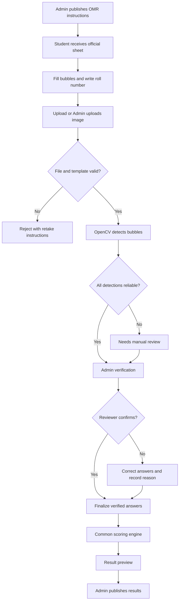

# App Flow and Navigation Specification
## Education Committee Competition Management System

## 1. Role-based navigation

### Public / unauthenticated
- Home
- Competitions
- Competition details
- Login
- Student registration / account creation
- Help and exam instructions

### Student
- Student dashboard
- My registrations
- Competition details and eligibility
- Online exam
- OMR upload (only if allowed for that competition)
- My results
- Profile / logout

### Admin
- Admin dashboard
- Competitions
- Registrations / students
- Question bank
- Answer key
- Online submissions
- OMR review queue
- Results preview
- Merit list publication/export
- Audit log
- Settings / logout

Hide links that a role cannot use, but remember that hiding UI is not security: the API must enforce permissions.

## 2. Student registration flow

## 3. Online MCQ flow

### Online exam states
- `not_started`
- `in_progress`
- `submitted`
- `timed_out`
- `evaluated`
- `result_published` (publication is competition/result state; do not rely on this alone as an attempt status)

The server's start time and deadline are authoritative. Client countdown is only a display. Save selected answers regularly and on change, debounce carefully, and display “Saved” / “Saving” / “Connection lost” status.

## 4. Paper OMR flow

### OMR statuses
- `uploaded`
- `processing`
- `needs_review`
- `reviewed`
- `verified`
- `rejected`
- `failed`

Do not equate `processing` or `reviewed` with verified. A submission is score-eligible only after `verified` (or a documented equivalent status approved by the admin).

## 5. Admin competition setup flow
1. Admin logs in.
2. Selects “Create Competition”.
3. Enters title, description, dates, mode, duration, marks, negative marking, and result policy.
4. Saves as `draft`.
5. Adds MCQ questions and options.
6. Enters answer key and checks question count/total marks.
7. Finalizes answer key before exam start.
8. Publishes competition and registration opens.
9. Closes registration at the configured time.
10. Conducts online exam and/or receives OMR sheets.
11. Resolves all required OMR reviews.
12. Generates result preview.
13. Checks tie-break policy and data quality.
14. Publishes result and merit list.

## 6. Result publication flow
- Only Admin can publish.
- Block publication if any expected submission is in an unresolved state, unless Admin explicitly excludes it with a recorded reason.
- Preview includes registration ID/roll number, mode, correct, incorrect, unanswered, penalty, score, rank, and review status.
- Public merit list contains only approved fields; no phone number, email, address, answer sheet image, or detailed answers.
- Record `publishedAt`, `publishedBy`, result version, and changes made after publication.
- Corrections after publication require an explicit republish/correction workflow and audit record.

## 7. Error and edge-case flows
- Duplicate registration: return existing registration safely or a `409 CONFLICT`; do not create a second registration.
- Exam window not open/closed: reject start/submit according to server time.
- Network loss: keep unsent state in memory and retry safely; only server-saved answers are guaranteed.
- Duplicate submit: return the existing submission/result state without scoring twice.
- OMR wrong student/roll number: send to admin review; do not auto-associate based only on OCR.
- Unsupported or unreadable image: reject with clear retake instructions.
- Multiple bubbles: mark answer uncertain; do not guess.
- Answer key modified after submissions: log change and require an explicit re-evaluation decision.
- Database or OMR service outage: show safe retry message; preserve already accepted uploads/answers.

## 8. Navigation rules
- Use a consistent top bar on public pages and a sidebar/drawer for admin navigation.
- On mobile, admin sidebar becomes a drawer; tables become horizontally scrollable or stacked cards.
- Preserve the current competition context when navigating between questions, OMR review, and results.
- Use confirmation dialogs for destructive actions and final publication.
