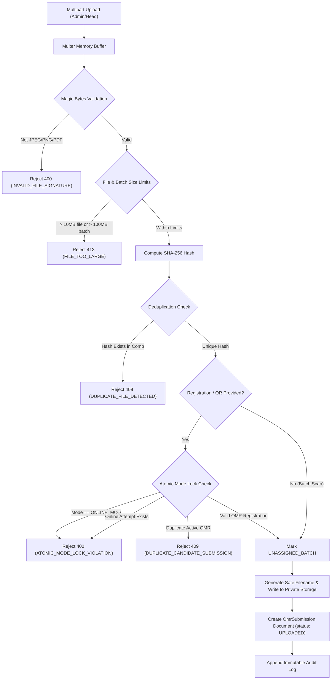

# Phase 6.3: Secure Image/PDF Upload & Registration Validation

## 1. Overview & Objective
Phase 6.3 establishes the secure ingestion gateway for paper OMR evaluation in the Education Committee Competition Management System. It guarantees that uploaded answer sheets:
- Conform strictly to authorized formats (JPEG, PNG, PDF) using real file magic bytes rather than untrusted client headers.
- Are protected against deduplication attacks via SHA-256 content hashes.
- Enforce **Atomic Exam Mode Locking** so candidates cannot switch between, or concurrently attempt, Online MCQ exams and Paper OMR exams.
- Are stored exclusively in an isolated private directory with absolute protection against path traversal and zero public static web exposure.
- Record comprehensive, document-level immutable audit trails for every upload, verification, or rejection event.

---

## 2. Security Architecture



---

## 3. Strict File Signature (Magic Bytes) Specification
Client-provided MIME headers and file extensions are inherently untrustworthy. Phase 6.3 inspects raw buffer headers before disk persistence:

| Format | Byte Length | Header Signature (Hex) | ASCII Representation |
| :--- | :--- | :--- | :--- |
| **JPEG** | 3 bytes | `FF D8 FF` | `ÿØÿ` |
| **PNG** | 8 bytes | `89 50 4E 47 0D 0A 1A 0A` | `\x89PNG\r\n\x1a\n` |
| **PDF** | 5 bytes | `25 50 44 46 2D` | `%PDF-` |

- **Truncated / Disguised Files**: Text files renamed as `.jpg` or `.pdf` are rejected immediately with `INVALID_FILE_SIGNATURE`.
- **Corrupted PDFs**: PDFs with fewer than 32 bytes or lacking valid `%PDF-` preamble are rejected with `CORRUPTED_PDF_TRUNCATED`.

---

## 4. Size Limits & Safe Storage
- **Per-File Limit**: 10 MB (`10 * 1024 * 1024` bytes).
- **Batch Limit**: 100 MB (`100 * 1024 * 1024` bytes).
- **Storage Location**: Private directory configured in `config.omrStorageDir` (`backend/storage/omr_private/`).
- **Path Traversal Guard**:
  ```javascript
  const baseDir = ensureStorageDir();
  const sanitizedName = path.basename(filename);
  const resolved = path.resolve(baseDir, sanitizedName);
  if (!resolved.startsWith(baseDir)) {
    throw new Error('PATH_TRAVERSAL_DETECTED');
  }
  ```
- **Zero Static Routes**: `backend/storage/omr_private` is **never** registered with `express.static`. Scans can only be downloaded by authorized Admins or Committee Heads via streaming endpoint `GET /api/v1/admin/competitions/:id/omr/submissions/:submissionId/file`.

---

## 5. Atomic Exam Mode Locking
To maintain strict competition integrity, candidates are bound to a single examination mode:
1. **Online Candidates Blocked from OMR**:
   - If an uploaded sheet references a registration with `examMode === 'ONLINE_MCQ'`, the request fails with `400 ATOMIC_MODE_LOCK_VIOLATION`.
   - If a candidate already has an `Attempt` record in status `IN_PROGRESS`, `SUBMITTED`, or `AUTO_SUBMITTED`, OMR upload is strictly rejected.
2. **OMR Candidates Blocked from Online Attempts**:
   - `exam.controller.js` checks `registration.examMode === 'OMR'` (returns `403 OMR_MODE_ONLY`).
   - `exam.controller.js` checks `OmrSubmission.exists(...)` (returns `403 ATOMIC_MODE_LOCK_VIOLATION`), ensuring an OMR submission permanently prevents online attempt creation.

---

## 6. Submission Lifecycle & Status Tracking
`OmrSubmission.status` tracks each scan across the evaluation pipeline:
- `UPLOADED`: Physical file validated, SHA-256 generated, safely stored on disk.
- `QUEUED`: Queued for background processing or OpenCV worker alignment.
- `PROCESSING`: Image deskewing, homography alignment, and bubble detection in progress.
- `NEEDS_REVIEW`: High uncertainty, damaged corner markers, or multiple filled bubbles requiring human verification.
- `FAILED`: Unrecoverable file defect or processing error.
- `VERIFIED`: Machine detections or manual reviews confirmed.

---

## 7. API Endpoints

### 7.1 Upload OMR Scans
- **Endpoint**: `POST /api/v1/admin/competitions/:id/omr/upload`
- **Auth**: `admin` or `committee_head`
- **Content-Type**: `multipart/form-data`
- **Fields**:
  - `file` (single) or `files` (up to 20 files)
  - `registrationId` (optional)
  - `qrToken` (optional, raw QR string or JSON object)
- **Response**: `201 Created` with created submissions and audit records.

### 7.2 List Submissions
- **Endpoint**: `GET /api/v1/admin/competitions/:id/omr/submissions`
- **Query Params**: `status`, `rollNumber`, `page`, `limit`
- **Response**: `200 OK` with paginated submission documents.

### 7.3 Get Submission Details
- **Endpoint**: `GET /api/v1/admin/competitions/:id/omr/submissions/:submissionId`
- **Response**: `200 OK` (private `storagePath` is automatically omitted from JSON response).

### 7.4 Secure File Stream
- **Endpoint**: `GET /api/v1/admin/competitions/:id/omr/submissions/:submissionId/file`
- **Auth**: `admin` or `committee_head`
- **Headers**: `Cache-Control: private, no-store`, `X-Content-Type-Options: nosniff`.
- **Response**: Binary image/PDF stream.

### 7.5 Verify & Link QR Token
- **Endpoint**: `POST /api/v1/admin/competitions/:id/omr/submissions/:submissionId/verify-qr`
- **Body**: `{ "qrToken": "{...}" }`
- **Response**: `200 OK` with linked registration and updated audit log.
