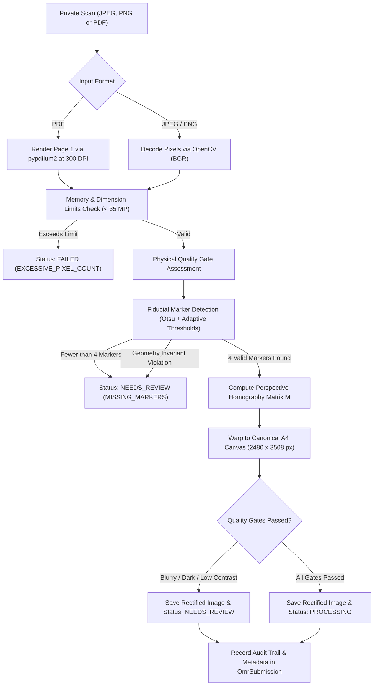

# Phase 6.4: OMR Image Alignment, Fiducial Marker Detection, Perspective Correction & Image Quality Validation

## 1. Overview & Objective
Phase 6.4 implements the computer vision pipeline responsible for transforming unaligned, rotated, or perspective-distorted physical OMR answer sheet scans into a canonical, rectified coordinate space.

It guarantees that:
1. **Four-Corner Fiducial Validation**: Exactly four solid square markers defined by `LAYOUT_A4_V1` are detected, verified, and mapped without guessing missing positions.
2. **Perspective Homography Rectification**: Sheets photographed or scanned with skew or perspective tilt are rectified to the standard 300 DPI A4 coordinate canvas ($2480 \times 3508$ px).
3. **Physical Image Quality Assessment**: Measurable metrics (Laplacian blur variance, luminance, contrast, resolution, and DPI) are computed to prevent unreadable scans from propagating into bubble extraction.
4. **Data Isolation & Integrity**: Aligned scans are stored strictly in private OMR storage; original uploads remain immutable; student roles are denied access; internal filesystem paths are never leaked over the wire.

---

## 2. Image-Processing Pipeline

---

## 3. Fiducial Marker Geometry & Coordinates

Derived directly from [`OMR_LAYOUT_SPEC`](file:///c:/Users/Abhishek%20Pal/OneDrive/Desktop/shiksha%20samiti%20committee/backend/src/services/omrPdfGenerator.service.js) in Phase 6.2:

- **Page Dimensions**: Standard ISO A4 ($595.28 \times 841.89$ pt at 72 pt/inch).
- **Canonical Canvas**: $2480 \times 3508$ pixels at 300 DPI.
- **Scale Factor**: $S_x = \frac{2480}{595.28} \approx 4.1661$, $S_y = \frac{3508}{841.89} \approx 4.1668$.
- **Marker Square Dimensions**: $26 \times 26$ pt ($\approx 108 \times 108$ pixels at 300 DPI).

| Marker | PDF Top-Left $(X, Y)$ pt | PDF Center $(X, Y)$ pt | Canonical Target Center $(X, Y)$ px |
| :--- | :--- | :--- | :--- |
| **Top-Left (TL)** | $(25.00, 25.00)$ | $(38.00, 38.00)$ | $(158.31, 158.31)$ |
| **Top-Right (TR)** | $(544.28, 25.00)$ | $(557.28, 38.00)$ | $(2321.69, 158.31)$ |
| **Bottom-Left (BL)** | $(25.00, 790.89)$ | $(38.00, 803.89)$ | $(158.31, 3349.09)$ |
| **Bottom-Right (BR)** | $(544.28, 790.89)$ | $(557.28, 803.89)$ | $(2321.69, 3349.09)$ |

### 3.1 Marker Detection Verification
- **Contour Filtering**: Area between $0.015\%$ and $2.0\%$ of total image area, aspect ratio between $0.60$ and $1.65$, solidity $\ge 0.65$, and dark fill intensity ($< 150$).
- **Quadrant Association**: Locates optimal candidates in the 4 corner margins ($< 42\%$ from boundaries).
- **Geometric Invariants**:
  - Spatial ordering: $TL.x < TR.x$, $BL.x < BR.x$, $TL.y < BL.y$, $TR.y < BR.y$.
  - Minimum segment lengths: $\min(W_{top}, W_{bot}, H_{left}, H_{right}) \ge 100$ px.
  - Quadrilateral Aspect Ratio: $1.05 \le \frac{H_{avg}}{W_{avg}} \le 1.85$ (expected A4 is $1.414$).
  - Keystone Distortion Check: $\frac{\max(W_{top}, W_{bot})}{\min(W_{top}, W_{bot})} \le 1.35$.

---

## 4. Perspective Correction & Transformation Method

Using the 4 detected marker centers as source coordinates and the canonical centers as destination coordinates:

$$\text{src} = \begin{bmatrix} TL_{x} & TL_{y} \\ TR_{x} & TR_{y} \\ BR_{x} & BR_{y} \\ BL_{x} & BL_{y} \end{bmatrix}, \quad \text{dst} = \begin{bmatrix} 158.31 & 158.31 \\ 2321.69 & 158.31 \\ 2321.69 & 3349.09 \\ 158.31 & 3349.09 \end{bmatrix}$$

1. **Homography Matrix**: Computed via `cv2.getPerspectiveTransform(src, dst)`.
2. **Matrix Validation**:
   - Check non-zero determinant: $|\det(M)| \ge 10^{-9}$.
   - Check condition number: $\text{cond}(M) \le 10^7$ (rejects extreme degenerate/folded warps).
3. **Bicubic Interpolation**:
   `cv2.warpPerspective(image, M, (2480, 3508), flags=cv2.INTER_CUBIC, borderMode=cv2.BORDER_CONSTANT, borderValue=(255, 255, 255))`.

---

## 5. Physical Image Quality Metrics & Thresholds

| Metric | Measurement Technique | Acceptable Range | Rejection Reason |
| :--- | :--- | :--- | :--- |
| **Blur / Sharpness** | Laplacian variance $\sigma^2(\nabla^2 I)$ | $\ge 40.0$ | `Image is too blurry` |
| **Brightness** | Mean luminance $\mu(I)$ (scale 0–255) | $60.0 \dots 253.5$ | `Severely underexposed` / `Overexposed` |
| **Contrast** | Standard deviation of luminance $\sigma(I)$ | $\ge 18.0$ | `Insufficient contrast` |
| **Resolution** | Image dimensions | $\ge 800 \times 1100$ px | `Resolution too low` |
| **Estimated DPI** | $\max(W / 8.27, H / 11.69)$ | $\ge 100$ DPI | `DPI too low` |
| **Pixel Limit** | $W \times H$ | $\le 35,000,000$ px | `Exceeds pixel limit (memory guard)` |

---

## 6. Submission Statuses & Error Handling

- **`PROCESSING`**: All 4 markers detected, quad geometry verified, perspective rectified to $2480 \times 3508$, and all quality gates passed.
- **`NEEDS_REVIEW`**: Perspective rectified or attempted, but requires administrative review because:
  - Fewer than 4 markers found (missing/torn corner).
  - Skew angle or keystone distortion excessive.
  - Image is blurry, underexposed, or low contrast.
- **`FAILED`**: Unrecoverable corruption:
  - File not found on disk.
  - Corrupted/unreadable PDF or image format.
  - Excessive dimensions ($> 35$ MP).

---

## 7. Storage, Security & Audit Logging

- **Original Scan Preservation**: The original file is **never modified or overwritten**. SHA-256 hashes remain identical before and after alignment.
- **Private Aligned Storage**: Aligned images are saved to `storage/omr_private/aligned_<submissionId>.png`.
- **Zero Public Exposure**:
  - `storagePath` and `alignedStoragePath` are deleted by Mongoose's `toJSON` transform.
  - Only authenticated Admins or Committee Heads can stream aligned images via `GET /api/v1/admin/competitions/:id/omr/submissions/:submissionId/aligned-file`.
  - Student accounts requesting alignment or aligned files receive HTTP 403 Forbidden.
- **Immutable Audit Trail**: Records `OMR_ALIGNMENT_PROCESSED` or `OMR_ALIGNMENT_REJECTED` with confidence, skew angle, and quality metrics.

---

## 8. Known Limitations & Scope Boundaries
- **No Bubble Detection**: Bubble grid extraction and darkness thresholding belong exclusively to Phase 6.5.
- **No Grading**: Student answers and mark calculations are strictly disallowed in this phase.
- **Single Page OMR**: Current pipeline processes page 1 of multi-page scans (standard OMR is 1 page).
