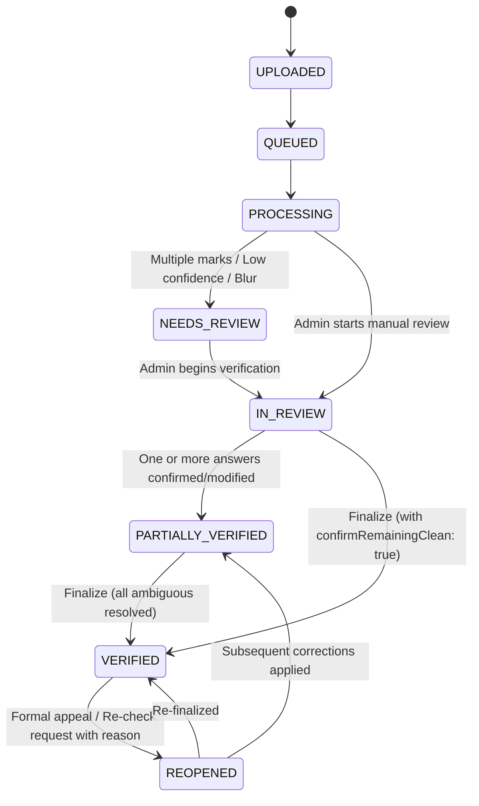

# Phase 6.6: OMR Admin Manual Answer Verification

## 1. Executive Summary

Phase 6.6 introduces a secure, responsive, and auditable **Admin Manual Verification Workflow** for OMR answer sheets. It bridges automated machine vision detection (Phase 6.4 fiducial alignment & Phase 6.5 bubble classification) and administrative examination oversight.

### Core Objectives
* **Human-in-the-Loop Verification**: Enable authorized administrators and committee heads to review, confirm, or correct candidate responses on physical OMR sheets.
* **100% Immutability of Machine Detections**: The raw machine vision detections (`rawDetections`) and the physical uploaded/aligned image scans remain permanently unedited.
* **Audited Human Answers**: All human judgments are stored separately in `confirmedAnswers` with reviewer identity, timestamp, mandatory justification for changes, and sequential history in `correctionHistory`.
* **Optimistic Concurrency Control**: Prevents concurrent reviewers from silently overwriting each other's edits through version checking (`version`).
* **Strict Security Boundaries**: Verification endpoints and raw scans remain strictly restricted to `admin` and `committee_head` roles. Student access to manual review APIs and scan storage paths is completely prohibited.

---

## 2. Submission State Machine

Submissions progress through the following verified states:



### State Definitions
| Status | Description |
| :--- | :--- |
| `UPLOADED` | Raw file uploaded and private storage path assigned. |
| `QUEUED` | Placed in processing queue. |
| `PROCESSING` | Fiducial alignment (Phase 6.4) and bubble extraction (Phase 6.5) underway. |
| `NEEDS_REVIEW` | Machine vision flagged ambiguity (multiple marked options, low fill confidence, missing fiducials). |
| `IN_REVIEW` | Review session initiated by an Admin or Committee Head. |
| `PARTIALLY_VERIFIED`| Some questions have been confirmed or corrected by the reviewer. |
| `VERIFIED` | Full verification locked. Submission ready for scoring integration (Phase 6.7). |
| `REOPENED` | A verified submission has been reopened due to a formal re-checking appeal. |

---

## 3. Data Schema & Immutability Architecture

All manual verification records are segregated from automated detections:

```
OmrSubmission
├── rawDetections (IMMUTABLE - never modified after Phase 6.5)
│   ├── detectedAt: Date
│   ├── totalQuestions: Number
│   ├── layoutType: 'twoColumn' | 'fourColumn'
│   ├── summary: { total, singleMarked, blank, multipleMarked, uncertain, overallConfidence, needsReview }
│   └── answers: [ { questionNumber, classification, detectedOption, confidence, markedOptions, needsReview } ]
│
├── confirmedAnswers (HUMAN VERIFICATION RECORD)
│   ├── status: 'PENDING' | 'IN_REVIEW' | 'PARTIALLY_VERIFIED' | 'VERIFIED' | 'REOPENED'
│   ├── verifiedBy: ObjectId (Ref: User)
│   ├── verifiedAt: Date
│   ├── isFullyVerified: Boolean
│   ├── reviewNotes: String
│   ├── version: Number (Optimistic Concurrency Counter)
│   ├── answers: Map<String, {
│   │     selectedOption: 'A' | 'B' | 'C' | 'D' | 'BLANK',
│   │     isConfirmed: Boolean,
│   │     isCorrected: Boolean,
│   │     reason: String,
│   │     confirmedBy: ObjectId (Ref: User),
│   │     confirmedAt: Date
│   │   }>
│   └── correctionHistory: [ {
│         questionNumber: Number,
│         previousOption: String,
│         newOption: String,
│         reason: String,
│         correctedBy: ObjectId (Ref: User),
│         correctedAt: Date
│       } ]
│
└── auditTrail: [ { action, actorId, timestamp, details } ]
```

---

## 4. REST API Specification

All Phase 6.6 routes require authentication and either `admin` or `committee_head` role.

### 4.1 Start Review
* **Endpoint**: `POST /api/v1/admin/competitions/:id/omr/submissions/:submissionId/start-review`
* **Description**: Transitions status from `NEEDS_REVIEW` or `UPLOADED` to `IN_REVIEW`.
* **Response (HTTP 200)**:
```json
{
  "success": true,
  "data": {
    "id": "6ae0724eec3b223ebd716b2a",
    "status": "IN_REVIEW",
    "confirmedAnswers": {
      "status": "IN_REVIEW",
      "version": 1,
      "isFullyVerified": false
    }
  }
}
```

### 4.2 Update / Confirm Question Answer
* **Endpoint**: `PUT /api/v1/admin/competitions/:id/omr/submissions/:submissionId/answers/:questionNumber`
* **Payload**:
```json
{
  "selectedOption": "A",
  "reason": "Option B was struck out by candidate with an X; mark on A is valid.",
  "expectedVersion": 1
}
```
* **Validation & Concurrency**:
  - `selectedOption`: Must be one of `A`, `B`, `C`, `D`, `BLANK`.
  - `reason`: Mandatory whenever overriding machine detection, resolving `MULTIPLE_MARKED`, or resolving `UNCERTAIN`.
  - `expectedVersion`: If provided, must match the current document version. If mismatched, returns `HTTP 409 CONCURRENT_REVIEW_CONFLICT`.
  - Verified Lock: If submission status is `VERIFIED`, returns `HTTP 400 SUBMISSION_ALREADY_VERIFIED`.

### 4.3 Finalize Verification
* **Endpoint**: `POST /api/v1/admin/competitions/:id/omr/submissions/:submissionId/finalize-verification`
* **Payload**:
```json
{
  "confirmRemainingClean": true,
  "reviewNotes": "All 50 questions checked against physical scan. Discrepancies resolved."
}
```
* **Guard Rules**:
  - If any `MULTIPLE_MARKED` or `UNCERTAIN` questions remain unconfirmed, the request is rejected with `HTTP 400 UNRESOLVED_QUESTIONS_REMAIN`.
  - When `confirmRemainingClean` is true, all unflagged `SINGLE_MARKED` and `BLANK` questions without human edits are automatically confirmed using their machine detections.
  - Submission status transitions to `VERIFIED`.

### 4.4 Reopen Verification
* **Endpoint**: `POST /api/v1/admin/competitions/:id/omr/submissions/:submissionId/reopen-verification`
* **Payload**:
```json
{
  "reason": "Student submitted formal re-evaluation appeal for Question 12."
}
```
* **Behavior**:
  - Status transitions to `REOPENED`.
  - Event recorded in submission `auditTrail`.
  - Unlocks submission for further manual corrections.

---

## 5. Security & Access Boundaries

1. **Role Enforcement**: `requireAdminOrHead` middleware prevents students, unauthenticated callers, or unauthorized actors from accessing any verification endpoint or private scan stream.
2. **Zero Storage Path Leakage**: Mongoose `toJSON` transform ensures `storagePath` and `alignedStoragePath` are stripped from all API outputs.
3. **Data Immutability**: Neither `PUT` nor `POST` operations modify `rawDetections`, the original uploaded scan file, or the aligned scan file on disk.

---

## 6. Frontend Admin Workspace (`AdminOmrReview.jsx`)

The frontend implementation provides a complete verification interface built with the project's Navy/Royal Blue design system:

* **Queue Deck**: Visual listing of OMR submissions with candidate roll number, review state badge, and confidence score.
* **Scan Canvas & Viewer**: High-resolution zoomable viewer with toggle between original scan and aligned scan.
* **Question Verification Grid**: Shows machine-detected answer, confidence bar, warning flags (`MULTIPLE_MARKED`, `UNCERTAIN`), and interactive buttons (`A`, `B`, `C`, `D`, `BLANK`).
* **Reason Modal**: Forces descriptive reason prompt whenever overriding machine classification.
* **Audit Timeline**: Displays real-time history of previous corrections, reasons, and reviewer identities.
* **Localization Parity**: 100% of UI elements and modal prompts are localized in both English (`en`) and Hindi (`hi`).

---

## 7. Test Verification & Reconciliation Summary

The dedicated test suite in `backend/test/phase6_6_verification.test.js` covers 17 distinct functional cases:

1. `Access Control: Authorized Admin can start review, update answers and finalize`
2. `Access Control: Authorized Committee Head can access review and update answers`
3. `Access Control (Security): Student access denied to all review endpoints (HTTP 403 Forbidden)`
4. `Access Control (Security): Unauthenticated request is rejected (HTTP 401 Unauthorized)`
5. `Access Control (Security): Private scan and aligned files are blocked from student access`
6. `Access Control (Security): Student API responses do not expose OMR review data or server paths`
7. `Verification: Single answer confirmation records reviewer and confirmed state`
8. `Verification: Blank answer confirmation is recorded as BLANK`
9. `Verification: Multiple-marked answer correction requires reason and updates answer`
10. `Verification: Uncertain answer correction is manually resolved with reason`
11. `Verification (Immutability): Raw detections and physical files remain 100% unchanged after corrections`
12. `Verification (Audit Trail): Correction history records previous value, new value, reason and reviewer`
13. `Workflow: Incomplete verification cannot be finalized (HTTP 400 UNRESOLVED_QUESTIONS_REMAIN)`
14. `Workflow: Full verification finalizes submission to VERIFIED status`
15. `Workflow: Cannot modify verified submission without reopening (HTTP 400)`
16. `Workflow: Reopening verified submission transitions to REOPENED with audit trail`
17. `Concurrency: Conflicting concurrent reviewer updates are rejected with HTTP 409`

### Test Runner Count Reconciliation
* Total named test cases: **17**
* Root suite container: **1** (`=== PHASE 6.6: OMR ADMIN MANUAL ANSWER VERIFICATION ===`)
* Node test runner (`node:test`) reported total: **18** (`pass 18`, `fail 0`)
* Discrepancy explanation: In Node's native test runner, the parent test suite block is counted as a test item in the summary summary (`tests 18, pass 18`), exactly matching the 17 individual test assertions plus the parent suite container.
