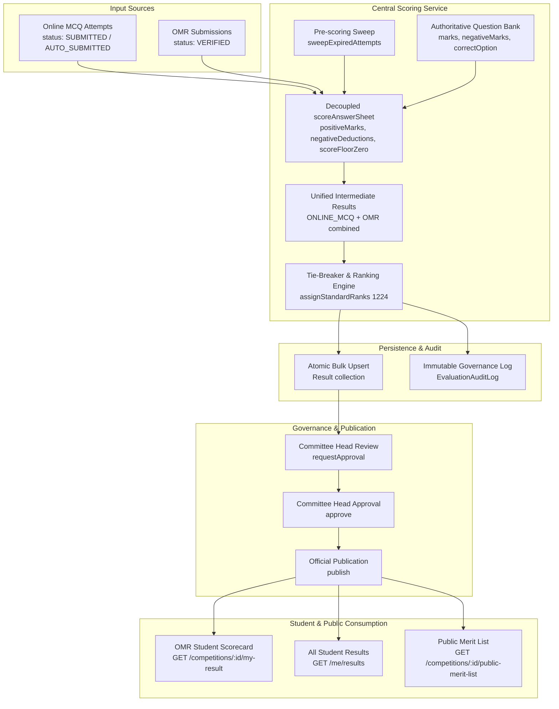

# Phase 6.7: OMR Scoring Engine Integration, Unified Merit List & Scorecard Publishing

## 1. Executive Summary

Phase 6.7 completes the end-to-end integration of the **Phase 6 OMR Pipeline** with the **Phase 5 Central Scoring & Merit List Engine**. With this milestone, physical paper OMR exam candidates and digital online MCQ candidates are evaluated seamlessly, scored using identical authoritative question bank definitions and negative marking rules, ranked fairly in a unified standard competition merit list, and published under the oversight of the Committee Head.

---

## 2. Architecture & Data Flow

---

## 3. Key Enhancements & Implementations

### 3.1 Result Model Updates (`backend/src/models/result.model.js`)
* **Flexible Identification**: Made `attemptId` optional (`default: null`) and added `omrSubmissionId` (`default: null`).
* **Partial Unique Indexes**:
  - `{ attemptId: 1 }` with `{ unique: true, partialFilterExpression: { attemptId: { $type: 'objectId' } } }`
  - `{ omrSubmissionId: 1 }` with `{ unique: true, partialFilterExpression: { omrSubmissionId: { $type: 'objectId' } } }`
  - Kept `{ competitionId: 1, studentId: 1 }` with `{ unique: true }` to guarantee strictly one result per candidate per competition across all modes.
* **Serializers**: Updated `toAdminMeritJSON` to serialize both `attemptId` and `omrSubmissionId` safely.

### 3.2 Hybrid Scoring Orchestrator (`backend/src/services/scoring.service.js`)
* **Authoritative Answer Mapping**: Maps verified OMR answers from `confirmedAnswers.answers` (fallback to `rawDetections.answers`).
* **Blank Marking Handling**: Questions marked `BLANK` are treated as unattempted (0 marks awarded, 0 deductions).
* **Unverified OMR Guard**: If any OMR sheets remain unverified (`NEEDS_REVIEW`, `IN_REVIEW`, etc.), evaluation is blocked with `HTTP 400 UNVERIFIED_OMR_SUBMISSIONS_REMAIN` unless the administrator explicitly provides `allowUnverifiedOmr: true`.
* **Standard Competition Ranking (1224)**: Evaluates online attempts and verified OMR sheets together, ordering candidates by `FINAL_SCORE`, `CORRECT_ANSWERS`, `INCORRECT_ANSWERS`, and `SUBMISSION_TIME`.

### 3.3 Publication Gate & Student Scorecard
* **Zero-Leak Protection**: OMR candidates cannot access results while status is `EVALUATED` or `APPROVED` (`HTTP 403 RESULT_NOT_PUBLISHED`).
* **Official Publishing**: Once Committee Head calls `POST /api/v1/admin/competitions/:id/publish`, candidates can immediately view verified scores, rank, and performance breakdown via:
  - `GET /api/v1/competitions/:id/my-result`
  - `GET /api/v1/me/results`
* **Public Merit List**: When `isPublicMeritListEnabled` is toggled by Committee Head, the public merit list renders both online and OMR candidates with zero PII leakage.

---

## 4. Test Verification Suite (`backend/test/phase6_7_scoring_integration.test.js`)

The dedicated integration test suite covers 16 comprehensive functional cases:

1. `Scoring: Verified OMR submission is evaluated using authoritative question marking keys (positive marks calculated)`
2. `Scoring: Negative marking is applied accurately on incorrect OMR answers according to competition config`
3. `Scoring: Blank / unattempted OMR questions receive 0 marks and 0 negative deductions`
4. `Scoring: Score floor zero prevents final score from dipping below 0 on heavy penalty`
5. `Unified Merit List: Combines ONLINE_MCQ attempts and OMR submissions into a single cohesive ranking`
6. `Unified Merit List: Standard competition ranking (1224) accurately handles score ties between online and OMR candidates`
7. `Unified Merit List: Tie-breaker criteria properly order candidates`
8. `Guard: Evaluation is blocked (HTTP 400 UNVERIFIED_OMR_SUBMISSIONS_REMAIN) if any OMR sheets are pending review or verification`
9. `Guard: allowUnverifiedOmr flag permits evaluation of verified submissions while skipping unverified sheets`
10. `Publication Gate: OMR student cannot access scorecard while results are EVALUATED or APPROVED (HTTP 403 RESULT_NOT_PUBLISHED)`
11. `Publication Gate: Committee Head approves and publishes; verified OMR candidate can access own scorecard (HTTP 200)`
12. `Student Scorecard: OMR candidate scorecard returns accurate breakdown, correct rank, and zero server path or answer key leakage`
13. `Student All Results: GET /api/v1/me/results lists published OMR competition results for candidate`
14. `Public Merit List: Public merit endpoint includes both online and OMR candidates when enabled by Committee Head`
15. `Audit Trail: EvaluationAuditLog records hybrid evaluation metrics (evaluatedOnlineCount, evaluatedOmrCount)`
16. `Re-evaluation: Re-evaluation increments scoringVersion, updates audit logs, and requires descriptive justification`

### Node Test Runner Count
* Individual sub-tests: **16**
* Root suite container: **1** (`=== PHASE 6.7: OMR SCORING ENGINE INTEGRATION & UNIFIED MERIT LIST ===`)
* Reported by test runner: **17 passed**, **0 failed**.
