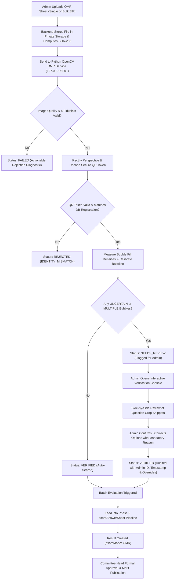

# Phase 6 Implementation Plan: OMR Sheet Template Generation, Physical Answer Sheet Scanning & Computer Vision Evaluation

**Status:** Architecture Review Complete — Awaiting Final User Approval  
**Date:** October 26, 2026  
**Target System:** Education Committee Competition Management System  
**Previous Phases:** Phase 0 through Phase 5.1 (Fully Implemented, Audited & Certified)  

---

## 1. Executive Overview & Objectives

Phase 6 implements the paper-based examination workflow, completing the hybrid examination vision defined in the project PRD:
1. **Printable OMR Sheet Generation:** Generate standard, print-ready A4 OMR answer sheets customized with competition metadata, student roll numbers, secure HMAC-signed QR codes, and fiducial alignment targets.
2. **Computer Vision Scanning Engine (`omr-service`):** A dedicated, hardened Python + OpenCV service to rectify perspective distortion, assess image quality, decode secure QR identifiers, and detect bubble fill densities.
3. **Rigorous Image Validation:** Detect blur, illumination non-uniformity/shadows, rotation, perspective keystone distortion, and cropped edges, rejecting unreadable scans with actionable diagnostics rather than guessing scores.
4. **Configurable Thresholds & Calibration:** Adaptive bubble fill classification (`detected`, `blank`, `multiple`, `uncertain`) calibrated against paper baseline luminance.
5. **Human-in-the-Loop Admin Verification:** An audited verification console requiring explicit administrator confirmation for any ambiguous bubble, while permanently preserving raw machine detections.
6. **Unified Central Scoring Integration:** Feed verified OMR answers directly into the audited Phase 5 scoring engine (`scoreAnswerSheet`) to generate standard `Result` records alongside online MCQ attempts.
7. **Strict Route Lockout & Concurrency Safety:** Guarantee the `one final result per registration` invariant with atomic database route locking and idempotency guards.
8. **Defense-in-Depth Security:** Restrict image access to authorized administrators, store files in private non-public directories, and isolate the Python microservice on `127.0.0.1` behind an internal shared secret.

---

## 2. System Architecture

```
┌────────────────────────────────────────────────────────────────────────┐
│                          Frontend (React + Vite)                       │
│  - Admin: OMR Sheet PDF Generator & Downloader                         │
│  - Admin: Single & Batch OMR Image Upload (with live validation)       │
│  - Admin: Interactive Verification Console (Crop Viewer & Overrides)   │
│  - Student: Download Personalized OMR Hall Ticket / Sheet (if enabled) │
└───────────────────────────────────┬────────────────────────────────────┘
                                    │ HTTPS (Cookie / Bearer)
┌───────────────────────────────────▼────────────────────────────────────┐
│                       Express API Gateway (Node.js)                    │
│  - Route-lock authorization middleware (Online vs OMR exclusivity)     │
│  - Multipart file upload validation (magic bytes & size limits)        │
│  - Private file storage manager (`backend/storage/omr_private/`)       │
│  - OMR Submission management (`omrSubmissions` collection)             │
│  - Inter-service client with `X-Internal-Service-Key` header           │
│  - Central scoring pipeline (`scoring.service.js`)                     │
│  - Committee approval & merit list integration                         │
└───────────────────────────────────┬────────────────────────────────────┘
                                    │ Internal Private HTTP (127.0.0.1:8001)
┌───────────────────────────────────▼────────────────────────────────────┐
│              Hardened Python OpenCV OMR Service (FastAPI)              │
│  - Auth Guard: Validates `X-Internal-Service-Key`                      │
│  - Quality Validation: Laplacian variance, brightness gradient, aspect │
│  - Perspective Transform: Corner fiducial detection & homography       │
│  - QR Decoding: Secure token extraction `{ v, cid, rid, sig }`        │
│  - Adaptive Bubble Grid Analysis: Paper white baseline calibration     │
│  - Threshold Classification: `DETECTED`, `BLANK`, `MULTIPLE`, `UNCERTAIN`│
└────────────────────────────────────────────────────────────────────────┘
```

---

## 3. Database Schema Changes & Enhancements

### 3.1 New Model: `OmrSubmission` (`backend/src/models/omrSubmission.model.js`)
Persists scanned sheets, raw computer detections, administrator overrides, confidence metrics, and verification audit trails.

```javascript
{
  competitionId: { type: ObjectId, ref: 'Competition', required: true, index: true },
  registrationId: { type: ObjectId, ref: 'Registration', required: true, index: true },
  studentId: { type: ObjectId, ref: 'User', required: true, index: true },
  uploadedBy: { type: ObjectId, ref: 'User', required: true },
  
  // Storage paths (Private directory outside web root, e.g. backend/storage/omr_private/)
  originalImagePath: { type: String, required: true },
  rectifiedImagePath: { type: String, default: null },
  imageHash: { type: String, required: true, index: true }, // SHA-256 for deduplication
  
  // OMR Template Specifications
  templateVersion: { type: String, default: 'A4_100Q_V1' },
  totalQuestions: { type: Number, required: true },
  
  // Processing & Review Status Machine:
  // UPLOADED -> PROCESSING -> NEEDS_REVIEW -> REVIEWED -> VERIFIED -> REJECTED -> FAILED
  status: {
    type: String,
    enum: ['UPLOADED', 'PROCESSING', 'NEEDS_REVIEW', 'REVIEWED', 'VERIFIED', 'REJECTED', 'FAILED'],
    default: 'UPLOADED',
    index: true
  },
  
  // Image Quality & Alignment Diagnostics
  qualityChecks: {
    passed: { type: Boolean, default: false },
    blurScore: { type: Number, default: 0 },          // Variance of Laplacian (min 100)
    isBlurry: { type: Boolean, default: false },
    illuminationScore: { type: Number, default: 0 },   // Standard deviation across 4 quadrants
    isIlluminatedProperly: { type: Boolean, default: true },
    skewAngleDegrees: { type: Number, default: 0 },    // Must be within [-15, +15]
    aspectRatioRatio: { type: Number, default: 1 },    // Rectified aspect ratio vs A4 (1.414)
    fiducialsDetected: { type: Number, default: 0 },   // Must be exactly 4
    warnings: [String],
    failureReason: { type: String, default: null }     // Structured error if rejected
  },
  
  // Secure QR Code / Identity Extraction
  extractedIdentity: {
    competitionId: { type: String, default: null },
    registrationId: { type: String, default: null },
    signature: { type: String, default: null },
    isSignatureValid: { type: Boolean, default: false },
    isMatchWithRegistration: { type: Boolean, default: false }
  },
  
  // Raw CV Detections (IMMUTABLE after extraction)
  detectedAnswers: [
    {
      questionNumber: { type: Number, required: true },
      detectedOption: { type: String, enum: ['A', 'B', 'C', 'D', null], default: null },
      state: {
        type: String,
        enum: ['DETECTED', 'BLANK', 'MULTIPLE', 'UNCERTAIN'],
        required: true
      },
      confidence: { type: Number, min: 0, max: 1 },
      fillRatios: {
        A: Number,
        B: Number,
        C: Number,
        D: Number
      },
      cropCoordinate: {
        x: Number,
        y: Number,
        width: Number,
        height: Number
      },
      warning: String
    }
  ],
  
  // Final Confirmed Answers (Post-Admin Verification & Overrides)
  confirmedAnswers: [
    {
      questionNumber: { type: Number, required: true },
      confirmedOption: { type: String, enum: ['A', 'B', 'C', 'D', null], default: null },
      isManuallyOverridden: { type: Boolean, default: false },
      originalDetectedOption: { type: String, default: null }
    }
  ],
  
  // Review & Verification Audit Trail
  needsReviewReason: String,
  reviewNotes: String,
  reviewedBy: { type: ObjectId, ref: 'User', default: null },
  reviewedAt: { type: Date, default: null },
  verifiedBy: { type: ObjectId, ref: 'User', default: null },
  verifiedAt: { type: Date, default: null },
  
  // Result Link
  resultId: { type: ObjectId, ref: 'Result', default: null },
  
  timestamps: true
}
```

#### Compound Indexes:
- `{ competitionId: 1, registrationId: 1 }` (unique constraint for active accepted submission).
- `{ competitionId: 1, imageHash: 1 }` (prevents duplicate submission processing).
- `{ competitionId: 1, status: 1 }` (fast filtering in admin review console).
- `{ studentId: 1, competitionId: 1 }`.

---

### 3.2 Updates to Existing Models

1. **`Registration` Model**:
   - `lockedMode`: `'ONLINE_MCQ' | 'OMR' | null`.
   - `lockedModeAt`: `Date | null`.
   - `omrSheetToken`: Cryptographically random 16-byte hex token bound to registration, used to generate and verify secure OMR QR codes without exposing PII.
   - Atomic condition: If `lockedMode === 'ONLINE_MCQ'` or an `Attempt` document exists, OMR uploads are strictly rejected with HTTP 400 `ONLINE_ATTEMPT_ALREADY_EXISTS`.
2. **`Competition` Model**:
   - `omrConfig`:
     ```javascript
     {
       templateLayout: { type: String, default: 'A4_100Q_V1' },
       fillThreshold: { type: Number, default: 0.45 },
       blankThreshold: { type: Number, default: 0.15 },
       blurThreshold: { type: Number, default: 100 },
       calibrationBaseline: { type: Number, default: 0 }
     }
     ```
3. **`Result` Model**:
   - `examMode`: `'ONLINE_MCQ' | 'OMR'`.
   - `sourceSubmissionId`: `ObjectId` (links to `Attempt` or `OmrSubmission`).

---

## 4. QR Security & OMR Sheet Layout

### 4.1 Secure, Non-Guessable QR Code Protocol
- **Zero PII Exposure:** The QR code **must never** contain student names, mobile numbers, dates of birth, school names, or roll numbers in plaintext.
- **Payload Structure:**
  ```json
  {
    "v": 1,
    "cid": "<competitionId>",
    "tok": "<registration.omrSheetToken>",
    "sig": "<HMAC_SHA256(secret, cid + ':' + tok).substring(0, 16)>"
  }
  ```
- **Backend Verification:**
  1. Computes expected HMAC using server secret (`config.jwtSecret` or `config.omrSecret`).
  2. If signature does not match, rejects scan immediately with `QR_SIGNATURE_INVALID`.
  3. Queries database for `Registration` matching `{ competitionId: cid, omrSheetToken: tok }`.
  4. Confirms student account is active and registration is `CONFIRMED`.
  5. Prevents brute-force ID guessing or spoofing other candidates' answer sheets.

### 4.2 Canonical Geometry (A4 300 DPI: 2480 x 3508 pixels)
1. **Four Corner Fiducials:**
   - 4 solid black squares ($120 \times 120$ px) placed at exact 15mm offsets from page edges: Top-Left, Top-Right, Bottom-Left, Bottom-Right.
   - Enables homography calculation to rectify rotation, skew, scaling, and camera tilt.
2. **Header Block:**
   - Competition Title & Date (Human-readable).
   - High-contrast secure QR Code ($350 \times 350$ px) in the top-right header box.
   - Roll number bubble grid (6 digits, 0–9) as secondary fallback if QR code is damaged.
3. **Bubble Grid Columns:**
   - Layout for up to 100 questions organized in 2 vertical columns (Questions 1–50, 51–100).
   - Each row: Question Number ($Q\#$), Option circles (A), (B), (C), (D).
   - Circle diameter: 28 px (~2.4 mm), stroke width 2 px.
   - Horizontal pitch: 42 px center-to-center.
   - Vertical pitch: 36 px center-to-center.
4. **Generation Technology:**
   - Server-side Node.js generator using `pdfkit` and `qrcode`.
   - Generates exact printable PDF with crisp vector lines and 300 DPI QR code.
   - Generates both **Generic Blank Sheets** and **Pre-filled Personalized Sheets**.

---

## 5. Computer Vision & OpenCV Pipeline (`omr-service`)

### 5.1 Image Quality Validation & Rejection Criteria
The Python service will reject degraded sheets **before** attempting bubble evaluation:

| Quality Check | Inspection Method | Threshold / Boundary | Action on Failure |
|---|---|---|---|
| **Blur Check** | Variance of Laplacian ($\sigma^2$) | $\sigma^2 \ge 100$ | Reject with `IMAGE_TOO_BLURRY` |
| **Illumination / Shadow** | Quadrant luminance deviation | Std dev between 4 corner ROIs $\le 35$ | Flag with `SHADOWS_DETECTED` |
| **Rotation / Skew** | Angle between top fiducials | $|\theta| \le 15^\circ$ | Reject with `EXCESSIVE_ROTATION` |
| **Perspective Distortion** | Rectified quadrilateral aspect ratio | $1.35 \le \text{height}/\text{width} \le 1.48$ | Reject with `KEYSTONE_DISTORTION` |
| **Cropped Sheet** | Contour hierarchy search for fiducial squares | Count $== 4$ | Reject with `MISSING_CORNER_FIDUCIALS` |

> **Hard Invariant:** Any sheet failing critical quality checks transitions to `FAILED` with explicit user-facing instructions (e.g. *"Image is too blurry. Please retake photo in bright, uniform lighting ensuring all 4 black corner squares are visible"*). Unreadable sheets are **never** scored.

### 5.2 Perspective Rectification (Homography)
1. Grayscale conversion $\rightarrow$ Gaussian Blur ($5 \times 5$) $\rightarrow$ Otsu adaptive thresholding.
2. Find external contours with `cv2.findContours`.
3. Filter contours by square aspect ratio ($0.85 \le w/h \le 1.15$) and expected area.
4. Order corner points: Top-Left, Top-Right, Bottom-Right, Bottom-Left.
5. Compute perspective transformation matrix using `cv2.getPerspectiveTransform`.
6. Warp image with `cv2.warpPerspective` to canonical canvas dimensions ($2480 \times 3508$ px).

### 5.3 Bubble Detection & Fill Analysis
1. **Paper White Baseline Calibration:**
   - Sample unprinted white margin strip ($100 \times 400$ px).
   - Compute mean baseline luminance $L_{base}$ and standard deviation.
   - Dynamically adjust binary threshold to account for yellowish paper, off-white newsprint, or low camera exposure.
2. **Circular ROI Masking:**
   - For Question $Q \in \{1 \dots N\}$ and Option $opt \in \{A, B, C, D\}$:
   - Extract circular mask of radius $R = 12$ px at pre-calibrated canonical center coordinates $(x_{q, opt}, y_{q, opt})$.
   - Calculate fill ratio:
     $$\text{fillRatio} = \frac{\text{Count of dark pixels inside mask}}{\text{Total pixels inside mask}}$$
3. **Threshold Classification:**
   - $\text{fillRatio} \ge 0.45$: **FILLED**
   - $\text{fillRatio} \le 0.15$: **BLANK**
   - $0.15 < \text{fillRatio} < 0.45$: **UNCERTAIN** (smudge, eraser shadow, light checkmark)
4. **State Classification & Ambiguity Resolution:**
   - **`DETECTED`**: Exactly 1 option is FILLED; other 3 options are BLANK.
   - **`BLANK`**: All 4 options are BLANK.
   - **`MULTIPLE`**: $\ge 2$ options are FILLED (e.g., student changed their mind without erasing).
   - **`UNCERTAIN`**: Any option has a fill ratio in the uncertain band ($15\% \dots 45\%$) OR top two bubbles differ by less than $10\%$.

---

## 6. End-to-End Processing & Review Workflow



---

## 7. API Specifications

### 7.1 Template Generation APIs
- **`GET /api/v1/admin/competitions/:id/omr/template-pdf`**
  - **Auth:** Admin or Committee Head
  - **Query:** `type=generic|personalized&registrationId=...`
  - **Response:** PDF binary download (`application/pdf`) with accurate millimeter margins and secure QR code.

### 7.2 OMR Sheet Upload & Processing APIs
- **`POST /api/v1/admin/competitions/:id/omr/upload`**
  - **Auth:** Admin or Committee Head
  - **Payload:** `multipart/form-data` with `file` (single JPEG/PNG/PDF or bulk `.zip`, max 10MB per image, 50MB per zip)
  - **Logic:**
    1. Validates magic bytes (JPEG `FF D8 FF`, PNG `89 50 4E 47`, PDF `%PDF`).
    2. Computes SHA-256 `imageHash`; rejects duplicates for same competition.
    3. Saves file to private directory `backend/storage/omr_private/<competitionId>/`.
    4. Calls Python OMR service via internal HTTP with `X-Internal-Service-Key`.
    5. Creates `OmrSubmission` document.
    6. Atomically locks registration route (`lockedMode: 'OMR'`).

- **`GET /api/v1/admin/competitions/:id/omr/submissions`**
  - **Auth:** Admin or Committee Head
  - **Query:** `status=NEEDS_REVIEW|VERIFIED&page=1&limit=20`
  - **Response:** List of OMR submissions with summary flags, student info, and quality scores.

- **`GET /api/v1/admin/omr/submissions/:submissionId`**
  - **Auth:** Admin or Committee Head
  - **Response:** Full submission details, immutable `detectedAnswers`, mutable `confirmedAnswers`, quality checks, and review notes.

- **`GET /api/v1/admin/omr/submissions/:submissionId/crop/:questionNumber`**
  - **Auth:** Admin or Committee Head
  - **Response:** Cropped PNG snippet of the specific question's 4 bubbles for visual verification. Streams directly from private storage.

### 7.3 Manual Verification API
- **`POST /api/v1/admin/omr/submissions/:submissionId/verify`**
  - **Auth:** Admin or Committee Head
  - **Payload:**
    ```json
    {
      "confirmedAnswers": [
        { "questionNumber": 1, "confirmedOption": "A" },
        { "questionNumber": 2, "confirmedOption": "C" }
      ],
      "reviewReason": "Resolved smudge on Question 2 based on visual inspection"
    }
    ```
  - **Logic:**
    1. Preserves original `detectedAnswers` untouched.
    2. Updates `confirmedAnswers`, setting `isManuallyOverridden: true` where option differs from detected.
    3. Sets `status: 'VERIFIED'`, `verifiedBy: req.user._id`, `verifiedAt: new Date()`.
    4. Records immutable audit entry in `EvaluationAuditLog`.

---

## 8. Integration with Central Scoring Engine (Phase 5)

When the Admin triggers **Batch Evaluation** (`POST /api/v1/admin/competitions/:id/evaluate`):
1. The service queries all completed submissions:
   - Online MCQ attempts with status `SUBMITTED` or `AUTO_SUBMITTED`.
   - OMR submissions with status `VERIFIED`.
   - **Gating Rule:** Any OMR submission in `NEEDS_REVIEW` or `PROCESSING` blocks final evaluation, or is skipped with an explicit warning notice.
2. For each verified OMR submission:
   - Maps `confirmedAnswers` to question IDs using the authoritative `Question` documents ordered by `order`.
   - Calls the pure scoring function:
     ```javascript
     const evaluated = scoreAnswerSheet({
       questions: authoritativeQuestions,
       answers: omrSubmission.confirmedAnswers.map(ca => ({
         questionId: questionMap.get(ca.questionNumber)._id,
         selectedOption: ca.confirmedOption
       })),
       competitionConfig: competition
     });
     ```
3. Creates or updates the `Result` document with `examMode: 'OMR'` and `sourceSubmissionId: omrSubmission._id`.
4. Ranks all candidates (Online MCQ and OMR) together in the standard competition merit list using the configured tie-breaker rules.
5. All Phase 5 governance rules (`approve`, `publish`, `unpublish`, `public-merit-list`) apply identically.

---

## 9. Security Risks & Mitigation Strategies

| Risk | Threat | Mitigation Strategy |
|---|---|---|
| **Dual-Mode Submission Abuse** | Student attempts online exam and submits paper OMR sheet. | Atomic route locking (`lockedMode`). If an online attempt exists, OMR upload is rejected. If an OMR sheet is uploaded, online exam entrance is blocked. |
| **Malicious File Uploads** | Attacker uploads webshell, polyglot, or oversized image disguised as OMR scan. | Strict MIME validation via magic bytes (not file extension), 10 MB max file size, sanitized random filenames, stored strictly outside the web root. |
| **Silent False Bubble Detection** | Light eraser mark or pencil smudge treated as valid answer. | Strict double-threshold metric: fill density between 15% and 45% flags `UNCERTAIN` and forces manual admin verification. |
| **Private Image / PII Leakage** | Scanned OMR sheets or phone numbers exposed publicly. | All OMR image viewing endpoints require authenticated Admin or Committee Head session. Public merit list serializes zero file keys or contact info. |
| **Identity Impersonation** | Wrong student's roll number bubbled or scanned. | High-resolution QR code encoding competition and registration IDs verified automatically. Any mismatch flags `IDENTITY_MISMATCH` requiring manual resolution. |
| **Audit Trail Tampering** | Admin secretly alters student's confirmed answers. | Every manual confirmation and override records `originalDetectedOption`, `confirmedOption`, `reviewedBy`, and an immutable entry in `EvaluationAuditLog`. |
| **Unauthorized Microservice Access** | External client sends malicious payload to Python port. | Microservice binds only to loopback interface `127.0.0.1:8001`, protected by `X-Internal-Service-Key` header secret. |

---

## 10. Checklist of Unresolved Decisions & Testing Requirements

### 10.1 Unresolved Decisions (For Committee / Stakeholder Review)
- [ ] **Dec-1: Student Self-Upload vs Admin-Only Upload**:
  - *Recommendation:* Limit OMR upload strictly to Admins and Committee Heads for MVP. Paper sheets are collected at physical exam centers and scanned centrally by exam controllers.
- [ ] **Dec-2: Python Service Deployment Model**:
  - *Recommendation:* Run `omr-service` as an independent local daemon on `http://127.0.0.1:8001` managed alongside Node server during development and as a systemd service in production.
- [ ] **Dec-3: Secondary Roll Number Bubble Grid**:
  - *Recommendation:* Pre-printed personalized sheets with QR codes are primary. The manual 6-digit roll number bubble grid serves as a backup if the QR code is torn or stained.
- [ ] **Dec-4: Threshold Calibration Profile**:
  - *Recommendation:* Ship with safe defaults (`fill=0.45`, `blank=0.15`), and store competition-specific overrides in `competition.omrConfig`.

### 10.2 Testing Requirements Checklist
- [ ] **Test-1: CV Image Normalization & Quality Rejection**:
  - Perspective rectification on rotated (5°, 15°), skewed, and inverted test sheets.
  - Verification that blurry images (< 100 Laplacian variance) are rejected with `IMAGE_TOO_BLURRY`.
  - Verification that cropped sheets missing a corner fiducial are rejected with `MISSING_CORNER_FIDUCIALS`.
- [ ] **Test-2: Bubble Fill Metrics & Uncertainty Detection**:
  - Synthetic test sheets: 100% filled, 60% filled, 30% smudge (`UNCERTAIN`), 0% blank, and 2 bubbles filled (`MULTIPLE`).
- [ ] **Test-3: QR Code Cryptographic Verification**:
  - Valid signed QR token decodes and matches registration.
  - Tampered or cross-competition QR code fails with `QR_SIGNATURE_INVALID`.
- [ ] **Test-4: Dual-Mode Route Lockout Race Condition**:
  - Prove concurrent MCQ exam start and OMR upload cannot both succeed for one registration.
- [ ] **Test-5: Mandatory Human Verification Gate**:
  - Verify that an OMR submission in `NEEDS_REVIEW` cannot be scored or published in the merit list.
- [ ] **Test-6: Central Scoring Engine Integration**:
  - Verify verified OMR answers score identically to an online MCQ attempt with the same answers, applying correct/incorrect/negative deductions and tie-breakers.
- [ ] **Test-7: Audit Logging & Override Tracking**:
  - Ensure manual answer overrides record `originalDetectedOption`, `confirmedOption`, `reviewedBy`, and `reviewReason` in `EvaluationAuditLog`.

---

*This updated document is prepared for review. Implementation will begin only after explicit approval.*
