# Phase 7: Complete Frontend Audit, Admin Dashboard & UI Completion Report

**Date**: October 28, 2026  
**Status**: APPROVED & COMPLETE  
**Audited Git Checkpoints**: `checkpoint-phase-6-8` (`dfd1b67`) -> `checkpoint-phase-7`  
**System Architecture**: React (Vite) + Node.js / Express + MongoDB / Mongoose + Python FastAPI / OpenCV  

---

## 1. Executive Summary

Phase 7 executed a comprehensive frontend audit and completed all missing administrator, Committee Head governance, and student user interfaces without rebuilding working features.

Key milestones accomplished:
1. **Admin Dashboard Completion**: Added functional Student & Registration Management with real backend data (`GET /api/v1/admin/competitions/:id/registrations`), real-time search, exam mode indicators, and direct links to printable personalized OMR PDFs. Added Administrator Profile & Security Settings tab.
2. **Committee Head Governance Portal**: Resolved role-routing boundaries so Committee Head users seamlessly log in and access an elevated governance dashboard featuring exclusive evaluation approval/rejection, publication/unpublication controls, and public merit list visibility governance.
3. **Student Experience Audit**: Audited and preserved the Student Dashboard design while adding a dedicated Profile & Account Details modal, seamless exam mode indicators, and verification of zero data leaks (hidden answer keys, unapproved marks, and private server paths remain inaccessible).
4. **Design System & Responsive Alignment**: Standardized color tokens on the EdTech palette (Navy: `#101B35`, Royal Blue: `#0645E5`, Background: `#F5F6FA`) across all admin, governance, and student interfaces with full responsiveness on desktop, tablet, and mobile.
5. **Localization Parity**: Expanded translation dictionaries to **447 keys** in both Hindi (`hi`) and English (`en`) with **100% mutual parity**.
6. **Phase 6.5 Test-Count Reconciliation**: Reconciled the historical discrepancy between 15 and 14 tests in `phase6_5_bubbles.test.js`.

---

## 2. Complete Page & View Inventory

| View / Page | Primary Component | Authorized Role(s) | Implementation Status | Functional Highlights |
|---|---|---|:---:|---|
| **Public Landing Page** | `App.jsx` + `Header.jsx`, `Hero.jsx`, `ExamModes.jsx`, `CompetitionInfo.jsx`, `Footer.jsx` | Public / All | **Complete** | System health status pill, segmented Hindi/English switcher, dual examination mode overview, live registration modal, unified login modal. |
| **Student Registration Modal** | `RegisterModal.jsx` | Public | **Complete** | Live mobile number normalization, class/grade dropdown, password verification, HttpOnly session establishment. |
| **Unified Login Modal** | `LoginModal.jsx` | All | **Complete** | Role-aware login for students and administrators/Committee Head with role-mismatch detection and session creation. |
| **Student Dashboard** | `StudentDashboard.jsx` | `student` | **Complete** | Live exam countdown timer, competition explore & eligibility cards, registration modal with mode lock, hall ticket generator, published scorecard viewer, and new student profile modal. |
| **Online Exam Runner** | `ExamRunner.jsx` | `student` (mode: `ONLINE_MCQ`) | **Complete** | Fullscreen timed environment, anti-cheat tab-switching guards, palette navigation, auto-save answers, submit confirmation. |
| **Admin Dashboard Overview** | `AdminDashboard.jsx` (`overview`) | `admin`, `committee_head` | **Complete** | Real backend statistics (total competitions, published active, draft, total questions, total registrations), Committee Head governance overview banner, quick action shortcuts. |
| **Competition Management** | `AdminDashboard.jsx` (`competitions`) | `admin`, `committee_head` | **Complete** | Competition creation, editing, scheduling, eligibility rules, negative marking configuration, status transitions (Draft, Published, Closed, Archived). |
| **Question Bank Management** | `AdminDashboard.jsx` (`questions`) | `admin`, `committee_head` | **Complete** | Per-competition question authoring, multi-subject tag, option creation, correct answer keys, explanation field, deletion controls. |
| **Student & Registration Management** | `AdminDashboard.jsx` (`registrations`) | `admin`, `committee_head` | **Complete (New)** | Real-time candidate roster from backend, search filter, mode badges (`ONLINE_MCQ` vs `OMR`), single-click download of printable personalized OMR PDFs with embedded HMAC QR tokens. |
| **Exam Attempt Monitoring** | `AdminDashboard.jsx` (`attempts`) | `admin`, `committee_head` | **Complete** | Real-time candidate attempt status (In Progress, Submitted, Evaluated), score preview, submission timestamps. |
| **Results & Central Scoring** | `AdminDashboard.jsx` (`merit`) | `admin`, `committee_head` | **Complete** | Central evaluation trigger, tie-breaker order configuration, internal merit list table, two-tier approval actions, publication audit log history. |
| **OMR Ingestion & Review** | `AdminOmrReview.jsx` (`omr`) | `admin`, `committee_head` | **Complete** | Secure scan upload, OpenCV fiducial alignment, bubble detection, side-by-side zoomable scan viewer, question-by-question confirmation, correction reason tracking. |
| **Administrator & Governance Profile** | `AdminDashboard.jsx` (`profile`) | `admin`, `committee_head` | **Complete (New)** | Identity badge (Gold Crown 👑 or Blue Shield 🛡️), official credentials, session security audit info, governance authority checklist. |

---

## 3. Role-Wise Governance & Access Matrix

```mermaid
flowchart TD
    subgraph PublicAccess ["Public & Prospective Students"]
        Landing["Public Landing Page"]
        RegModal["Student Registration"]
        LogModal["Unified Login Modal"]
        PubMerit["Public Merit List (When Enabled)"]
    end

    subgraph StudentAccess ["Student Experience (Role: student)"]
        SDash["Student Dashboard"]
        Explore["Browse Competitions & Eligibility"]
        RegExam["Register (ONLINE_MCQ vs OMR)"]
        HallTicket["View Hall Ticket"]
        OnlineRunner["Take Online Exam"]
        Scorecard["View Published Scorecard"]
        StudentProfile["View Profile & Account Info"]
    end

    subgraph AdminAccess ["Administrator (Role: admin)"]
        ADash["Admin Dashboard"]
        ManageComp["Create & Edit Competitions"]
        ManageQ["Author Question Bank"]
        ManageRegs["Student & Registration Roster"]
        DownloadOMR["Generate Generic & Personalized OMR PDFs"]
        MonitorAttempts["Monitor Online Exam Attempts"]
        ReviewOMR["Ingest & Manually Verify OMR Sheets"]
        TriggerEval["Evaluate Attempts & OMR Sheets"]
        RequestApproval["Request Committee Head Approval"]
        AdminProfile["Account & Security Details"]
    end

    subgraph HeadAccess ["Committee Head (Role: committee_head)"]
        HDash["Governance Dashboard"]
        GovOverview["Governance Oversight Panel"]
        ApproveEval["Approve Evaluated Results"]
        RejectEval["Reject / Request Revision with Reason"]
        PublishResults["Publish Results to Students"]
        UnpublishResults["Recall / Unpublish Results with Reason"]
        TogglePublic["Toggle Public Merit List Access"]
        HeadProfile["Executive Governance Profile"]
    end

    LogModal -->|role: student| SDash
    LogModal -->|role: admin| ADash
    LogModal -->|role: committee_head| HDash

    ADash -->|Delegates Approval| ApproveEval
    HDash -.->|Holds Exclusive Authority| PublishResults
```



---

## 4. Completed UI Work

### 4.1 Admin Dashboard: Student & Registration Management
- Added a dedicated `registrations` tab in `AdminDashboard.jsx`.
- Backed by the new backend route: `GET /api/v1/admin/competitions/:id/registrations`.
- Displays real-time candidate statistics:
  - Total registered candidates
  - Online MCQ mode registrations count
  - OMR Pen & Paper registrations count
- Provides live client-side search by candidate name, roll number, school, and mobile.
- Features single-click download of the **Personalized OMR Sheet PDF** (`/api/v1/admin/competitions/:id/omr/template-personalized-pdf/:registrationId`), embedding the student's roll number and HMAC QR code.
- Features download of the **Generic Printable OMR Sheet PDF** (`/api/v1/admin/competitions/:id/omr/template-generic-pdf`).
- Includes direct cross-navigation to the Exam Attempt Monitoring tab for online MCQ candidates.

### 4.2 Committee Head Governance Integration
- Fixed role-boundary checks in `LoginModal.jsx`, `App.jsx`, and `AdminDashboard.jsx` so users with `role: committee_head` are fully authorized and routed directly to the governance interface.
- Overview tab renders a dedicated **Committee Head Governance Oversight Panel**:
  - Highlights competitions awaiting approval (`PENDING_APPROVAL` / `EVALUATED`).
  - Highlights competitions approved and ready for publication (`APPROVED`).
  - Highlights competitions currently published live (`PUBLISHED`).
  - Quick jump button directly to the competition's evaluation and merit list screen.
- Preserved strict backend authorization boundaries: Standard Admin cannot execute approve, publish, unpublish, or merit list toggle requests.

### 4.3 Administrator & Head Profile Tab
- Added dedicated `profile` tab in `AdminDashboard.jsx`.
- Features an executive identity card with role-specific emblems:
  - 👑 **Committee Head**: Gold-accented badge with executive governance checklist.
  - 🛡️ **Administrator**: Blue-accented badge with operational checklist.
- Displays normalized phone number, school/department, designation, and active session status.
- Explains the cryptographic session security architecture (HttpOnly cookie, CSRF token, zero sensitive payload leakage).

### 4.4 Student Dashboard: Profile & Account Details Modal
- Added `profileModalOpen` state and modal in `StudentDashboard.jsx`.
- Triggered by clicking the student profile pill in the top bar or the avatar in the greeting banner.
- Displays full name, mobile number, assigned class/grade, school name, registration counts, published scorecard count, and session security notice.

---

## 5. Design System & Responsive Verification

### Color Palette Alignment
- **Primary Navy**: `#101B35` (Used for header background, dark banner surfaces, brand text)
- **Royal Blue**: `#0645E5` (Used for primary action CTAs, active badges, highlights)
- **Neutral Page Background**: `#F5F6FA` (Clean, non-distracting canvas)
- **Surface Cards**: `#FFFFFF` with `border: 1px solid #E2E8F0` and subtle elevation shadows (`0 2px 12px rgba(15, 23, 42, 0.06)`)
- **Semantic Accents**:
  - Success / Live: `#10B981` / `#16A34A`
  - Warning / Draft: `#F59E0B` / `#D97706`
  - Error / Closed: `#EF4444` / `#DC2626`
  - OMR / Computer Vision: `#7C3AED`

### Responsive Breakpoints
1. **Desktop (>= 1024px)**:
   - Full multi-tab navigation header with quick actions.
   - 4-to-5 column metric cards grid.
   - Comprehensive tabular data views with inline action buttons.
2. **Tablet (768px - 1023px)**:
   - Wrapping navigation pill row.
   - 2-to-3 column metric cards grid.
   - Horizontally scrollable data tables with sticky headers.
3. **Mobile (< 768px)**:
   - Collapsible mobile drawer with touch targets >= 44px.
   - Stacked single-column card grids.
   - Responsive modal overlays with backdrop blur and full touch accessibility.

---

## 6. Localization (Hindi & English) Verification

- **Total Dictionary Keys**: **447** in `translations.hi` and **447** in `translations.en`.
- **Mutual Parity**: **100% (0 missing keys in either language)**.
- **Verification Suite**: `frontend/test/ui.test.js` passes all 24 automated localization and character assertions.
- **Language Switcher**: Segmented toggle in top navigation updates state instantly and persists choice to `localStorage` (`education_committee_lang`).

---

## 7. Security & Data Privacy Findings

1. **Role Enforcement**:
   - Backend APIs (`admin.routes.js`, `competition.routes.js`) enforce `requireAdminOrHead` and `requireCommitteeHead`.
   - The frontend never assumes authority; all action buttons reflect state from backend API responses.
2. **Student Privacy Protection**:
   - Students cannot view other candidates' roll numbers, private scores, or OMR scans.
   - The OMR private storage directory (`storage/omr/private/`) is not exposed via static routes.
   - `OmrSubmission` JSON transforms strip `storagePath` and `alignedStoragePath` before serialization.
3. **Publication Gating**:
   - Results are inaccessible to students until the Committee Head explicitly publishes them.
   - While in `APPROVED` or `EVALUATED` status, students receiving scorecard queries receive `HTTP 403 RESULT_NOT_PUBLISHED`.

---

## 8. Test Count Reconciliation (Phase 6.5)

### Problem Statement
An earlier report stated 15 tests for Phase 6.5, while the Phase 6.8 report recorded 14 tests.

### Codebase Inspection
Audited `backend/test/phase6_5_bubbles.test.js`:
- The file contains exactly **14** `await suite.test(...)` declarations:
  1. `Unit: Microservice detects clean single marks with high confidence` (line 255)
  2. `Unit: Microservice detects multiple marked bubbles on same question` (line 297)
  3. `Unit: Microservice detects light pencil and erased marks` (line 313)
  4. `Unit: Microservice handles slight bubble shift (+2px) without misclassification` (line 327)
  5. `Unit: Microservice handles 100-question fourColumn layout correctly` (line 337)
  6. `Unit: Non-existent aligned file fails safely with error` (line 356)
  7. `Integration: Admin executes bubble detection on clean sheet` (line 370)
  8. `Integration: Ambiguous sheet triggers NEEDS_REVIEW status` (line 397)
  9. `Integration: Submission without aligned image returns 400 ALIGNED_IMAGE_REQUIRED` (line 415)
  10. `Integration: Reprocessing bubble detection NEVER overwrites confirmedAnswers` (line 437)
  11. `Integration: Real generated Phase 6.2 OMR PDF end-to-end alignment and bubble detection` (line 470)
  12. `Security: Student cannot trigger bubble detection (HTTP 403 Forbidden)` (line 509)
  13. `Security: Unauthenticated request is rejected (HTTP 401 Unauthorized)` (line 522)
  14. `Security: JSON responses never expose server filesystem paths` (line 534)
- **Root Cause**: The earlier report inadvertently counted the top-level suite container / service health check step as a 15th test item.
- **Reconciled Truth**: The actual runner output is `ℹ tests 14, ℹ pass 14`. Exactly 14 test cases exist and pass in `phase6_5_bubbles.test.js`.

---

## 9. Automated Regression Results

| Test Suite | Scope | Tests Passed | Status |
|---|---|:---:|:---:|
| `frontend/test/ui.test.js` | UI & Bilingual Localization (Phases 2-7) | **24 / 24** | **PASS** |
| `backend/test/phase7_frontend_support.test.js` | Registration Management & Access Control | **4 / 4** | **PASS** |
| `backend/test/phase6_8_audit.test.js` | OMR Scoring Integrity & Concurrency | **9 / 9** | **PASS** |
| `backend/test/phase6_7_scoring_integration.test.js` | Unified Central Scoring Engine | **17 / 17** | **PASS** |
| `backend/test/phase6_6_verification.test.js` | OMR Admin Answer Verification | **18 / 18** | **PASS** |
| `backend/test/phase6_5_bubbles.test.js` | OMR Bubble Detection & OpenCV | **14 / 14** | **PASS** |
| `backend/test/phase6_4_alignment.test.js` | OMR Fiducial Alignment & Rectification | **19 / 19** | **PASS** |
| `backend/test/phase6_3_upload.test.js` | OMR Secure Multipart Upload & Mode Lock | **24 / 24** | **PASS** |
| `backend/test/phase6_2_omr_pdf.test.js` | Printable Generic & Personalized OMR PDFs | **13 / 13** | **PASS** |
| `backend/test/phase6_1_foundation.test.js` | OMR Microservice Foundation & Health | **9 / 9** | **PASS** |
| `backend/test/phase5_1_audit.test.js` | Scoring Governance & Audit Trail | **17 / 17** | **PASS** |
| `frontend` Vite Build | Production Asset Bundle Compilation | **40 modules** | **SUCCESS (0 errors)** |

* **Total Backend Automated Tests**: 144 / 144 PASS
* **Total Frontend Automated Tests**: 24 / 24 PASS
* **Overall Test Suite Status**: **168 / 168 PASS (100% SUCCESS)**

---

## 10. Production Build Verification

```
> education-committee-frontend@1.0.0 build
> vite build

vite v6.4.4 building for production...
transforming...
✓ 40 modules transformed.
rendering chunks...
computing gzip size...
dist/index.html                   0.75 kB │ gzip:   0.45 kB
dist/assets/index-BloGx7gY.css   15.49 kB │ gzip:   3.51 kB
dist/assets/index-CkBPaewu.js   450.58 kB │ gzip: 106.25 kB
✓ built in 1.35s
```

Production build produces zero warnings and compiles cleanly in 1.35 seconds.

---

## 11. Screenshots of Key Views

The following verified screenshots document the UI layout across desktop, tablet, and mobile breakpoints:

1. **Student Dashboard (Desktop View)**:
   

2. **Student Dashboard (Tablet View)**:
   

3. **Student Dashboard (Mobile View)**:
   

4. **Public Landing Page (Desktop English)**:
   

5. **Public Landing Page (Desktop Hindi)**:
   

---

## 12. Conclusion & Checkpoint Tag

All Phase 7 requirements have been successfully audited, implemented, tested, and documented.
The codebase is tagged with `checkpoint-phase-7`.
